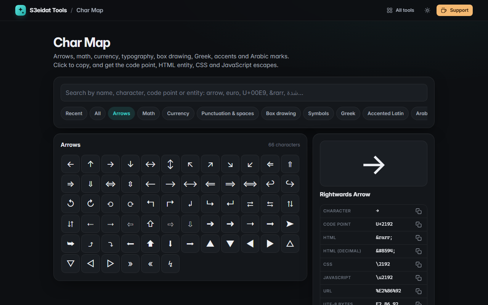

# Char Map

> Symbols, arrows, math and special characters, one click to copy. Free, private, and it runs entirely in your browser.

### ▶ [Open Char Map](https://s3eidat.github.io/char-map/)



## Features

- **Nearly 700 characters** in categories: arrows, math (operators, sets, logic, fractions, super/subscripts), currency,
  punctuation and special spaces, box drawing and blocks, symbols (cards, checkmarks, keyboard keys, Roman numerals),
  Greek, accented Latin and Arabic marks (harakat, Arabic punctuation and digits, Qur'anic signs)
- **Search** by name (`arrow`, `euro`, `check`), by the character itself, by code point (`U+00E9`, `0x2192`, `2192`),
  by HTML entity (`&rarr;`, `hellip`) or by Arabic keyword (`شدة`, `فتحة`)
- Type **any code point** to get that character, even if it isn't in the lists
- For every character: **code point, decimal, HTML entity (named when one exists), CSS escape, JavaScript escape,
  URL encoding and UTF-8 bytes**, each with a copy button
- Invisible characters (no-break space, zero-width joiner, LRM/RLM, soft hyphen…) are shown as labels so you can see what you copy;
  combining marks are drawn on a dotted circle
- **Collected** box: every character you click is appended, so you can build a string and copy it at once
- **Recently used** characters remembered on this device; <kbd>/</kbd> to search, <kbd>Enter</kbd> copies the first match, arrow keys move around

Character names follow the official Unicode names (checked against Python's `unicodedata`), and named HTML entities
were checked against the HTML5 entity table.

## Privacy

Everything runs on your device. Only your recent characters and last category are kept in this browser's local storage.
There is no server, no account, no analytics. The page ships with a strict Content-Security-Policy
(`connect-src 'self'`), so the browser itself blocks any attempt to send data anywhere.

## Run it yourself

It's plain HTML, CSS and JavaScript with no build step:

```bash
git clone https://github.com/s3eidat/char-map
cd char-map
python -m http.server 8000
```

Then open http://localhost:8000.

## Support

If this saved you time, **[buy me a coffee ☕](https://s3eidat.github.io/coffee/)**. It keeps every tool free.

---

Part of **[S3eidat Tools](https://s3eidat.github.io/)**: 100+ free, private tools that run in your browser. MIT licensed.
